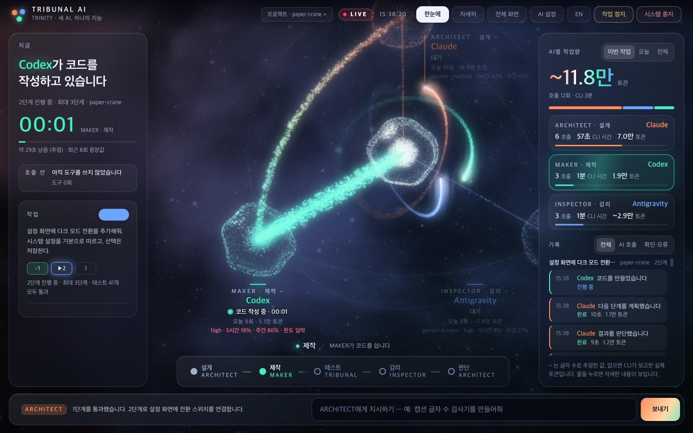

# Tribunal AI

구독으로 로그인해 둔 AI 코딩 CLI 세 개(Claude Code, OpenAI Codex, Google Antigravity)를 **설계 · 제작 · 감리** 세 역할로 나눠 돌리고,
목표 한 줄을 테스트와 독립 검토를 거친 코드로 바꾸는 로컬 개발 감독관입니다. 종량제 API는 쓰지 않습니다.

> **In English** — Tribunal AI is a local supervisor that runs three subscription AI coding CLIs (Claude Code, OpenAI Codex,
> Google Antigravity) as **architect, maker and inspector**, and turns a one-line goal into code that has passed tests and an
> independent review. Changes are made in an isolated git worktree and reach your project only when you apply them; the tests
> are run by the program itself, not by an AI; no metered API is used. Verified on macOS; the test suite passes on macOS, Windows and Linux in CI. The console has an English
> mode (the **EN** button); the documentation is in Korean.

> **출처** — 이 프로젝트는 MIT 라이선스 오픈소스 [AI DEV DIRECTOR](https://github.com/digilogd-cmd/ai-dev-director) v3.1.8을
> 바탕으로 만들었습니다. 원본의 저작권 표시와 라이선스 전문은 [LICENSE](LICENSE)에 그대로 있습니다.
> 원본에서 무엇을 물려받았고 무엇을 바꿨는지는 [docs/CHANGELOG.md](docs/CHANGELOG.md)에 있습니다.



<sub>데모 콘솔(`scripts/demo_console.py`)의 화면입니다. 보이는 작업과 숫자는 모두 지어낸 것입니다.</sub>

## 무엇을 하나

```
 목표 ──▶ ARCHITECT · 설계 ──▶ MAKER · 제작 ──▶ TRIBUNAL · 테스트 ──▶ INSPECTOR · 감리 ──▶ ARCHITECT · 판단
            지시서를 씀          파일을 제안        프로그램이 직접 실행      독립 검토            통과 / 수정 지시
                                    ▲                                                              │
                                    └────────────────────── 자동 수정 ────────────────────────────┘
```

- **작업과 단계** — 채팅 한 줄이 하나의 *작업*이 됩니다. ARCHITECT가 작업을 *단계*로 나누고, 단계마다 위 흐름을 한 번 돕니다.
- **원본은 건드리지 않음** — 모든 변경은 격리된 작업 사본(git worktree)에서만 일어납니다. 통과한 결과물은 변경 내용을 보고 나서
  원본에 적용하거나 폐기합니다.
- **테스트는 AI가 아니라 프로그램이** — 테스트 단계는 Tribunal 프로그램이 직접 명령을 실행하고 결과를 기록합니다.
- **사람에게 묻는 것은 네 가지뿐** — 돈이 드는 일, 실제 계좌 주문, 실제 자격증명, 되돌릴 수 없는 외부 행동. 그 밖의 막힘은
  재시도 · 다른 AI로 교체 · 다시 계획으로 스스로 풉니다.
- **AI가 빠져도 이어 감** — 한도 소진 · 로그인 풀림 · 응답 없음이면 그 AI를 기록하고 남은 AI로 역할을 옮깁니다. 쓸 수 있는 AI가
  하나도 없을 때만 멈춰서 묻고, 돌아오면 멈춘 곳부터 이어 갑니다.
- **콘솔** — 브라우저로 여는 화면에서 지시하고, 세 AI가 지금 무엇을 하는지 보고, 승인 · 거절 · 적용을 합니다.
- **실행해 보기** — 끝난 결과(웹 페이지, 창이 뜨는 앱, 터미널 프로그램)를 새 터미널 창에서 바로 실행해 봅니다. 실행할 명령을
  먼저 보여 주고, 적용 전 결과물은 임시 복사본에서 돌립니다.

## 지키는 것

| 규칙 | 구현 |
|---|---|
| 종량제 API 금지 — 로그인된 구독 CLI만 사용 | `core/env_utils.py`가 모든 `*_API_KEY`를 환경에서 지우고 CLI를 부름 |
| 원본 프로젝트 무수정 | 빌드와 테스트는 `.director_worktrees/` 안의 작업 사본에서만 |
| 범위 검사(Scope Guard) | 지시서의 허용 경로 · 보호 경로 · 파일 수 · 변경 줄 수를 Tribunal이 검사 (`core/safety.py`) |
| 감리는 닫힌 쪽으로 실패 | 감리 응답이 없거나 깨지면 통과가 아니라 실패 |
| 돈과 자격증명은 사람이 | `core/autopilot.py`의 정지 조건 |
| 멈춘 CLI는 자식 프로세스까지 종료 | `core/process_runner.py` |
| 정지는 정지 | 채팅의 "중단 / 멈춰 / stop", 콘솔의 작업 정지 → 돌던 CLI 즉시 종료, 재시작해도 이어 하지 않음 |
| 계정 정보를 읽지 않음 | 로그인 토큰과 비밀번호는 읽지 않고, 계정과 한도는 각 CLI에게 물어서만 앎 |
| 화면은 기록대로 | 기록에 없는 값은 "기록 없음", 추정값은 `~` 표시. 지켜본다고 실행 결과가 달라지지 않음 |

## 요구 사항

- **macOS** — 이 프로젝트를 실제로 돌리고 검증한 환경입니다.
- Linux — Docker(화면 없음)에서 테스트 모음, 콘솔 켜고 끄기, 작업 흐름을 확인했습니다. 데스크톱 화면(폴더 선택 창 등)은 확인 전이고,
  터미널 창을 여는 기능은 대신 실행할 명령을 보여 줍니다.
- Windows — 테스트 모음과 설치가 GitHub Actions에서 통과합니다. 사람이 화면을 직접 써 본 적은 아직 없습니다.
- 세 운영체제 모두 커밋마다 자동으로 시험합니다(`.github/workflows/tests.yml`).
- Python 3.9 이상, Git (테스트 모음은 3.9와 3.13에서 모두 통과)
- 로그인된 CLI 중 최소 두 개: `claude`, `codex`, `agy`. 구독 로그인 세션을 그대로 씁니다. API 키는 필요 없고, 있어도 무시됩니다.

## 비용

- **Tribunal AI는 무료입니다**(MIT 라이선스). 종량제 API 요금은 쓰지 않습니다.
- **대신 AI 회사의 구독이 필요합니다.** Claude Code(Anthropic), Codex(OpenAI · ChatGPT), Antigravity(Google) 중 최소 두 개를 각자의
  구독으로 로그인해 둬야 합니다. 셋이면 하나가 한도에 걸려도 이어 갑니다.
- **작업마다 구독 한도를 씁니다.** 작업 하나에 AI 호출이 여러 번 들어가고, 자동 수정이 많을수록 더 씁니다. 남은 한도는 콘솔의
  AI 설정에서 볼 수 있습니다.
- 요금과 한도는 각 회사가 정하고 바꿉니다. 각 서비스의 이용 약관을 따르세요.

## 빠른 시작

```bash
python3 -m venv .venv
.venv/bin/pip install -r requirements.txt
.venv/bin/python -m pytest -q        # CLI 없이 스텁으로 돕니다. 약 4분
```

콘솔 켜고 끄기:

```bash
sh start-companion.sh      # 주소를 출력합니다. 기본 http://127.0.0.1:8081
sh stop-companion.sh
```

실제 기록 없이 화면만 둘러보려면 지어낸 작업으로 채운 데모 콘솔을 씁니다. 읽기 전용이고 실제 데이터를 건드리지 않습니다.

```bash
.venv/bin/python scripts/demo_console.py      # http://127.0.0.1:8190
```

설치본으로 써 보기(개발 중인 미리보기, [uv](https://docs.astral.sh/uv/) 필요). 기록은 저장소가 아니라 사용자 데이터 폴더
(macOS `~/Library/Application Support/Tribunal AI`, Windows `%APPDATA%\Tribunal AI`, Linux `~/.local/share/tribunal-ai`)에 쌓입니다.

```bash
uv tool install .          # 저장소 폴더에서. `tribunal` 명령이 생깁니다
tribunal                   # 콘솔을 켜고 브라우저로 엽니다 (tribunal stop / doctor / do …)
```

명령줄에서 바로 한 번 돌리기:

```bash
.venv/bin/python director.py do -p ~/work/my_project "src/calc.py에 add(a, b)를 만들고 테스트를 추가해"
.venv/bin/python director.py do -p ~/work/my_project --profile quick --no-apply "로그인 버그 고쳐"
.venv/bin/python director.py status
```

## 문서

| 문서 | 내용 |
|---|---|
| [docs/ARCHITECTURE.md](docs/ARCHITECTURE.md) | 흐름, 세 역할과 Tribunal, 안전 장치, 기록, 파일 구조 |
| [docs/CONSOLE.md](docs/CONSOLE.md) | 한눈에 · 자세히 탭, 기록과 상세, 구름 속 · 핵 속 화면, AI 설정 |
| [docs/CONFIGURATION.md](docs/CONFIGURATION.md) | 설정 파일, 프로필, 이 컴퓨터 전용 설정 |
| [docs/DEVELOPMENT.md](docs/DEVELOPMENT.md) | 테스트, 실제 작업으로 시험하는 법, 화면이 쓰는 주소 |
| [docs/CHANGELOG.md](docs/CHANGELOG.md) | 원본 이후의 변경 이력, 물려받았지만 검증하지 않은 것 |
| [docs/PACKAGING.md](docs/PACKAGING.md) | 설치형 프로그램으로 만드는 계획 (웹 · 앱, macOS · Windows · Linux) |

## 알려진 한계

- MAKER가 파일 전체를 JSON으로 제안하는 방식이라, 큰 변경은 CLI 출력 한도에 걸릴 수 있습니다. 한 번은 압축해서 다시 시도하고,
  그다음은 다른 AI로 넘깁니다.
- 각 CLI의 구독 한도에 그대로 묶입니다. 한도가 끝나면 다른 CLI로 넘어갑니다.
- 감리와 설계가 같은 AI로 몰리면 "감리 독립성 낮음"을 표시하고 진행합니다. 숨기지 않습니다.
- 테스트 모음은 스텁 CLI로 돕니다. 실제 세 CLI를 끝까지 태우는 시험은 따로 선택해야 돌아갑니다.
- 창이 뜨는 Python 앱(tkinter)을 실행해 보려면 그 Python에 tkinter가 있어야 합니다. Homebrew Python은 따로 설치합니다
  (`brew install python-tk@3.13`). 없으면 확인 창이 미리 알려 줍니다.

## 라이선스

MIT License. [LICENSE](LICENSE)를 보세요.
